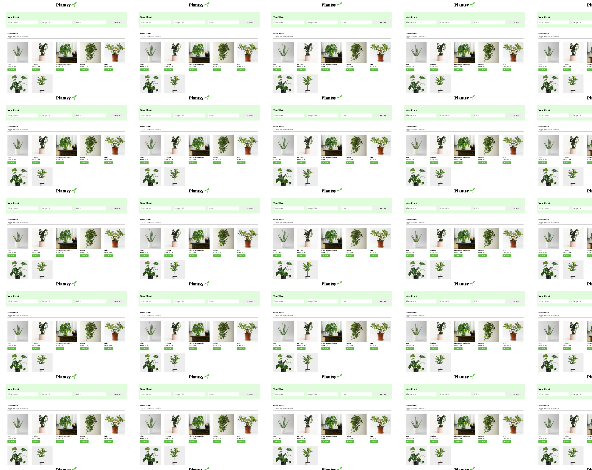

# Plantsy

Plantsy is a small plant-shop inventory app. Browse the plants loaded from the local JSON Server API, add a plant, toggle its in-stock status, and filter the list by name.



## Getting Started

Install the dependencies:

```sh
npm install
```


Start the backend and frontend in separate terminals:

```sh
npm run server
```

```sh
npm run dev
```

Open the Vite URL printed in the terminal, usually <http://localhost:5173/>. The API runs at <http://localhost:6001/>.

## Features

- Loads and displays plants from `GET /plants` when the page opens.
- Adds a plant through `POST /plants` and displays the saved API response.
- Toggles each plant between “In Stock” and “Out of Stock” for the current page session.
- Filters plant names as you type; clearing the search restores the full list.

## API

The included JSON Server uses `db.json` and exposes `GET /plants` and `POST /plants` on port `6001`. New plant requests contain `name`, `image`, and `price` fields. Stock status is currently managed in the browser and is not persisted by the provided API.

## Tests

Run the Vitest suite with:

```sh
npm run test
```